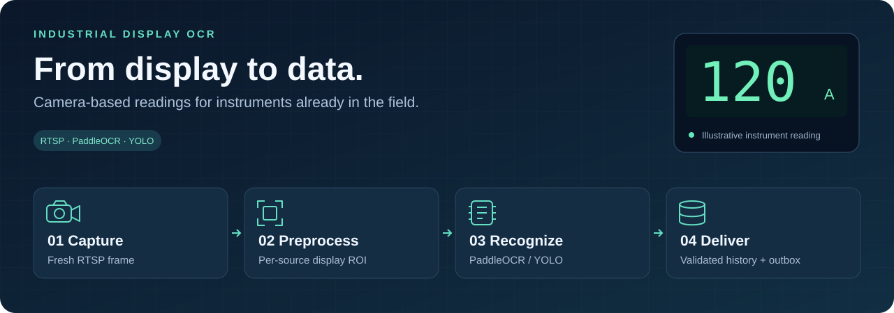
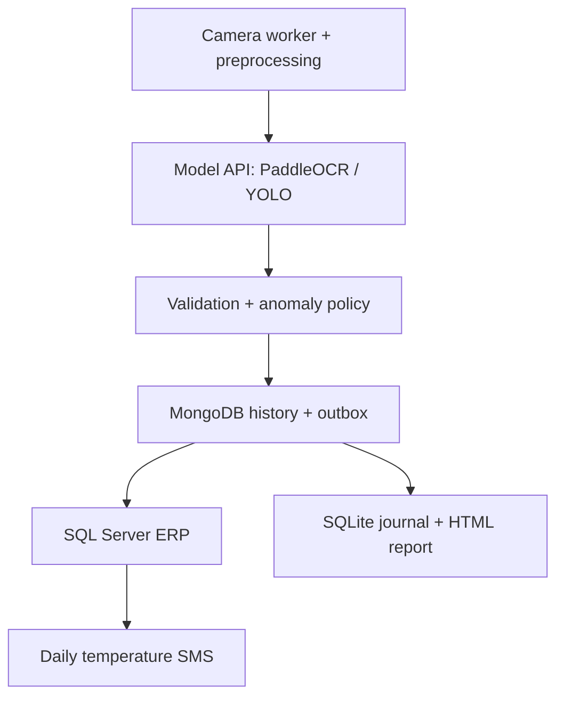
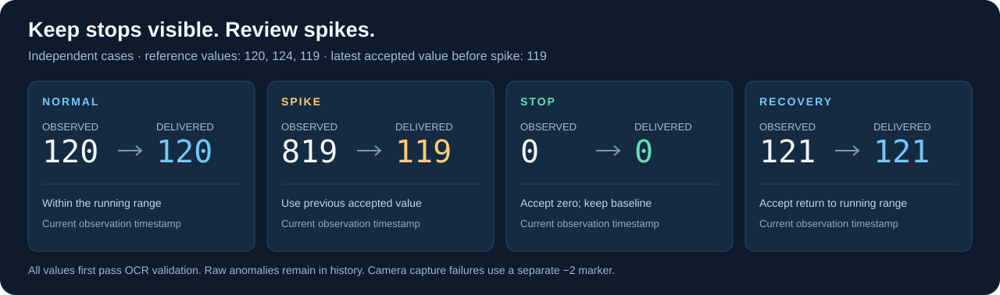

<div align="center">

# Industrial Display OCR

**Turn existing cameras and digital displays into timestamped operational data.**



[](https://github.com/MojtabaZarreh/industrial-display-ocr/actions/workflows/tests.yml)


[Quick start](#-quick-start) · [Architecture](docs/architecture.md) · [Models & training](docs/models-and-training.md) · [Operations](docs/operations.md)

</div>

Industrial Display OCR reads numeric values from camera-visible instruments and
connects them to measurement history, an ERP system, or local daily reports.
It combines **PaddleOCR sequence recognition**, **YOLO digit detection**,
per-camera preprocessing, temporal anomaly checks and durable delivery.

The project grew out of a real industrial deployment collecting motor-current
and temperature readings, forwarding them to an ERP system and sending daily
temperature summaries by SMS. This repository presents the reusable software;
camera examples, source descriptions and preprocessing profiles are generic.

## 🎯 Where it fits

| Application | What the software provides |
| --- | --- |
| Motor and production-line monitoring | Periodic current readings; valid zeros preserve evidence of a possible stop. |
| Server rooms and electrical rooms | Temperature history and a daily SMS summary. |
| Legacy digital instruments | Camera-based collection when a direct data interface is unavailable. |
| Dataset development | Preprocessed crops and predictions for review and future training. |
| Future instrument types | Weight/speed unit metadata; new instruments still need suitable models, routes and scale rules. |

A camera observes the display. Whether that observation means an equipment
fault depends on the instrument and operating context.

## ✨ What is included

- 📷 **Multiple RTSP sources:** independent schedules and concurrent camera workers.
- 🧠 **Two recognition paths:** complete numeric strings with PaddleOCR and individual digits with YOLO.
- 🛠️ **Per-source preprocessing:** crop, mask, intensity adjustment, grayscale and denoising.
- 🟢 **Zero-aware validation:** retain valid stops and accept recovery to the preceding operating range.
- 📦 **Durable delivery:** a MongoDB outbox separates observations from destination writes.
- 📨 **Daily SMS:** temperature minimum, maximum, average and record count through Ghasedak.
- 🗂️ **Reviewable samples:** images, predictions, timestamps, preprocessing metadata and hashes.
- 🐳 **Separate containers:** a lightweight worker and an independently callable model API.

## 🔎 How it works

1. A scheduled worker opens the camera stream, captures a fresh frame and closes it.
2. A source-specific preprocessing profile isolates and cleans the target display.
3. The model API selects a backend from the camera-code prefix.
4. The worker validates the response, extracts a number and checks accepted history.
5. MongoDB retains the reading; a delivery event is queued when the policy permits it.
6. A separate delivery worker sends the selected value to ERP or a local report.



The collector saves the already-preprocessed input sent to inference. Reviewed
samples can be reused without repeating camera ROI processing; model-specific
resize/normalization still applies during training.

### Concurrency and timing

The production worker uses a **32-thread camera pool**, with at most **one job
in flight per source**. Ampere sources have a **60-second target cadence**;
other units use their configured `schedule_interval`.

FastAPI offloads blocking inference to threads and admits up to
`OCR_MAX_CONCURRENCY` requests, default **4**. Each loaded backend also has a
prediction lock, so this does not mean four concurrent executions of one model.
Delivery and daily reports run separately from camera scheduling.

Samples keep their actual observation time. Slow cameras, model queues or
network failures can reduce the number of observations. There is no historical
backfill or guarantee of 1,440 successful readings per day.
See [architecture and timing](docs/architecture.md).

## 🧠 Models and measured accuracy

| Route | Backend | Task | Default artifact |
| --- | --- | --- | --- |
| `AMP-*` | PaddleOCR `PP-OCRv6_medium_rec` | Recognize a cropped numeric sequence | `services/weights/medium_digit_rec_v2/inference/` |
| `SRC-*` | Ultralytics YOLO | Detect digits and assemble them left to right | `services/weights/model1-new.pt` |

The Paddle recognizer uses a digit vocabulary and **3 × 64 × 320** input
configuration. Runtime extraction accepts **unsigned integer readings**.
Temperature decimal placement is a reporting rule, not OCR decimal-point
recognition. The API expects an already-preprocessed display image.

### Recorded PaddleOCR experiment

The supplied notebook's recorded `mixed` run produced:

| Personal hold-out split | Images | Exact sequence accuracy ↑ | Character error rate ↓ |
| --- | ---: | ---: | ---: |
| Validation | 148 | **93.92%** | **2.90%** |
| Test | 152 | **84.87%** | **7.55%** |

Exact accuracy requires the **entire string** to match. CER counts character
insertions, deletions and substitutions. These are historical notebook results
on one private-data split, not production-wide accuracy or scores for every
bundled checkpoint. The evaluated checkpoint was not fingerprint-linked to the
bundled runtime weights. Neither hold-out split contains zero-only examples;
zero-specific OCR accuracy is **not measured**. A YOLO metric is not available.

See the sanitized [evaluation record](docs/evaluation.json) and
[evaluation notes](docs/models-and-training.md#recorded-evaluation).
Confidence scores and software test results are separate from OCR accuracy.

## 📚 Training data and notebook

The [Colab notebook](notebooks/PP_OCRv6_medium_3datasets.ipynb) combines private
camera samples with **three external sources**:

| Source | Used in the recorded experiment | Role |
| --- | ---: | --- |
| Private display crops | 1,692 unique: 1,392 train / 148 validation / 152 test | Target-domain training/evaluation; images are not included. |
| [MiXaiLL76 / 7SEG_OCR](https://huggingface.co/datasets/MiXaiLL76/7SEG_OCR) | 1,643 accepted from 3,333 source rows | External training sequences after label-policy and hold-out exclusions. |
| [chakibmed / bp-monitor-seven-segment](https://huggingface.co/datasets/chakibmed/bp-monitor-seven-segment) | 388 single-digit crops | Training only; full multi-row screens are not given a single-number label. |
| [renjithsasidharan / seven-segment-ocr](https://github.com/renjithsasidharan/seven-segment-ocr) | 319 recognition crops | Training only, using original text annotations. |

The run used **3,742 unique training images** before sampling and augmentation.
External images do not enter personal validation/test sets. Exact pixel
duplicates are checked, and label-based splitting excludes public strings
matching personal hold-out labels. Session/device grouping is available for
stronger separation of related frames.

All 45 notebook cells are included with saved outputs cleared. The workflow
covers audits, augmentation, training, validation, testing and inference export.
Its current recovery cell skips optional personal adaptation; see the
[training guide](docs/models-and-training.md#reproduce-or-extend-the-experiment).

## 🟢 Zeros, anomalies and unavailable cameras



*Illustrative policy example, not a production screenshot.*

After OCR validation, a numeric zero is always accepted. Nonzero values are
compared to the median of up to **10 preceding accepted nonzero readings**.
With at least **3** references, a change greater than **50%** of that median is
anomalous by default.

| Observation | Stored / delivered behavior |
| --- | --- |
| Valid `0` | Store and queue every zero; preserve the nonzero baseline. |
| Return from `0` to the usual range | Accept against the retained baseline. |
| Nonzero spike, e.g. `819` after values around `120` | Retain the raw anomaly; deliver the latest preceding accepted value at the current observation time. |
| Empty, malformed or low-confidence OCR | Retain for review; do not convert to `0` or a camera-failure marker. |
| Camera capture failure | Queue `-2` for that failed observation; exclude it from accepted OCR history and the anomaly baseline. |

Capture uses **one attempt**, with 5-second open and read timeouts. The next
scheduled capture still runs. Persistent out-of-range changes are not
automatically learned as a new baseline. This supports downstream stop analysis;
immediate stop/spike SMS alarms are not implemented.
See the [complete reading policy](docs/reading-delivery.md).

## 🚀 Quick start

Use Docker Compose for the worker, model API and MongoDB:

```sh
git clone https://github.com/MojtabaZarreh/industrial-display-ocr.git
cd industrial-display-ocr
```

Copy `.env.example` to `.env`, and
`infrastructure/database/mongodb/cameras.example.json` to
`infrastructure/database/mongodb/cameras.json`. Fill your RTSP URLs, then
calibrate and enable profiles in `config/camera_preprocessing.json`. Included
profiles are disabled examples.

Set a shared `DETECTION_API_KEY`, MongoDB credentials and consistent database
names in `.env`. For a first run without an ERP connection:

```dotenv
YOURCOMPANY_ERP_ENABLED=false
DAILY_REPORT_ENABLED=false
MODEL_API_BIND=127.0.0.1
```

The existing adapter retains its `YOURCOMPANY_*` setting names. Fill the required
MongoDB settings in [`.env.example`](.env.example): the Docker URI uses host
`mongodb`, while host-side commands use `127.0.0.1`.

```sh
docker compose build
docker compose up -d --wait mongodb model-api
docker compose run --rm --no-deps worker python -m infrastructure.database.mongodb.import_measurement_points infrastructure/database/mongodb/cameras.json
docker compose up -d worker
docker compose logs -f --tail 100 worker model-api
```

Interactive API documentation is at `http://localhost:8000/docs`. Direct request:

```sh
curl -X POST http://localhost:8000/predict/AMP-001 -H "X-API-Key: YOUR_LONG_RANDOM_KEY" -F "file=@preprocessed-display.jpg"
```

On PowerShell, use `curl.exe`. `GET /health` is unauthenticated process liveness;
models load lazily on the first matching request. See [Docker deployment](docs/docker.md)
for standalone containers, external access, volumes and logs, or
[operations](docs/operations.md#environment-and-api-access) for local Uvicorn execution.

## 📊 ERP or local reports

With `YOURCOMPANY_ERP_ENABLED=true`, selected values go to SQL Server through a
retryable MongoDB outbox. The supplied adapter targets `ServerRoomTemp`; map it
to your ERP schema before enabling ERP mode. SQL delivery is retryable, not a
distributed exactly-once transaction.

With `false`, delivery writes a **SQLite journal** and **daily HTML reports**
with per-camera counts and a filterable record table: observation time,
file-write time, unit, raw/displayed values, zeros and unavailable markers.

```sh
docker compose cp worker:/app/storage/yourcompany_exports ./yourcompany_exports
```

Open `readings-YYYY-MM-DD.html`. Keep `records.sqlite3` alongside the reports;
it deduplicates local retries. Existing ERP events pause in file mode;
already-queued file events remain file-bound. See [delivery behavior](docs/operations.md#delivery-and-local-reports).

## 📨 Daily temperature SMS

With ERP delivery and reporting enabled, the scheduler sends the preceding
Tehran calendar day's summary at **06:01 Asia/Tehran**. Sections contain minimum,
maximum, average and record count for active Celsius sources. Descriptions must
match ERP `RecordType` values.

```dotenv
YOURCOMPANY_ERP_ENABLED=true
DAILY_REPORT_ENABLED=true
GHASEDAK_API_KEY=YOUR_KEY
GHASEDAK_LINE_NUMBER=YOUR_LINE
DAILY_REPORT_RECIPIENTS=RECIPIENT_1,RECIPIENT_2
```

Configure `YOURCOMPANY_DB_*` credentials too. Raw temperature `217` becomes
**21.70 °C** before report statistics; stored OCR/ERP values stay unchanged.
Zero is included; `-2` and non-finite values are excluded. File mode does not
produce ERP-backed SMS reports. See [the reporting example](docs/operations.md#daily-sms-reports).

## 🗂️ Data for the next model

Samples use `CAMERA_CODE/YYYY-MM-DD/SAMPLE_ID/`, containing `image.png` and
`metadata.json`. Metadata includes predictions, timestamps, dimensions, a
SHA-256 hash and the preprocessing profile. The PNG contains pixels decoded
from the JPEG actually sent to inference.

Predictions are **candidate labels**, not ground truth. New samples have
`verified_label=null` and `review_status="pending"`; review/correct them before
training. Collection does not automatically retrain or promote a model.
See [the data lifecycle](docs/architecture.md#dataset-lifecycle).

## 🧪 Tests and project map

```sh
python -m pip install -r tests/requirements-unit.txt
python -m pytest
```

The isolated suite uses fake cameras/models/ERP/SMS and in-memory MongoDB.
GitHub Actions runs it on Linux/Windows and Python 3.11/3.12, then builds both
containers and exercises both routes. `scripts/manual/` contains opt-in checks
that contact actual services when explicitly run.

| Path | Responsibility |
| --- | --- |
| `application/` | Capture, preprocessing, validation, collection, delivery and reporting. |
| `services/detection/`, `services/models/` | FastAPI endpoints and model adapters. |
| `domain/` | Measurement units and domain models. |
| `infrastructure/` | MongoDB repositories, ERP/file adapters and SMS. |
| `config/` | Environment settings, logging and preprocessing profiles. |
| `notebooks/` | Training and export workflow. |
| `tests/unit/`, `scripts/manual/` | Isolated tests and manual integration checks. |

## 📖 Documentation and acknowledgements

- [Architecture, concurrency and data lifecycle](docs/architecture.md)
- [Models, datasets, evaluation and training](docs/models-and-training.md)
- [Configuration, reports and troubleshooting](docs/operations.md)
- [Reading and anomaly delivery policy](docs/reading-delivery.md)
- [Docker deployment and logs](docs/docker.md)

Built on [PaddleOCR](https://github.com/PaddlePaddle/PaddleOCR),
[PaddlePaddle](https://github.com/PaddlePaddle/Paddle),
[Ultralytics](https://github.com/ultralytics/ultralytics), OpenCV, FastAPI and MongoDB.
Dataset authors are credited above and in the training guide. Dependencies,
external datasets and pretrained weights retain their own licenses and
attribution requirements. This repository does not add a license grant for
third-party assets. Private camera images and credentials are not included.
